# Credit Risk Scorecard & IFRS 9 Expected Credit Loss Engine


An end-to-end retail credit risk pipeline: SQL warehouse → weight-of-evidence scorecard →  
probability-of-default, loss-given-default and exposure-at-default models → IFRS 9 three-stage  
expected credit loss with probability-weighted macro scenarios.

It is built the way a bank builds it, not the way a tutorial builds it: chronological splits, a  
leakage guard that is enforced by a test, a 12-month default definition that keeps PD and the ECL  
horizon on the same clock, and a model selection rule that discards any component which cannot beat  
the simple benchmark it replaces.

---

## 1. Business context and problem statement

Retail lenders must hold a provision against expected credit losses *before* a loan defaults. Under  
IFRS 9 that provision is

```
ECL = PD x LGD x EAD        discounted, and over a horizon that depends on the loan's stage
```

and it has to be reported under a range of macro scenarios, not a single point estimate. Three  
problems have to be solved in sequence, and each one feeds the next:

| # | Problem                                                                      | Why it is hard                                                                                                                                               |
| - | ---------------------------------------------------------------------------- | ------------------------------------------------------------------------------------------------------------------------------------------------------------ |
| 1 | Rank borrowers by default risk and produce an explainable, monitorable score | A black box cannot be used for credit decisioning, and a score that cannot be decomposed into points cannot be defended to a credit committee or a regulator |
| 2 | Convert a ranking into a *probability*                                       | A provision is a level calculation; a well-ranked but badly calibrated PD misstates the allowance                                                            |
| 3 | Convert PD into a provision                                                  | Requires a loss model, an exposure model, staging logic, discounting and scenario design                                                                     |

This repository answers all three on a 120,000-loan book, and states explicitly where the answer is  
a policy choice rather than a measurement.

## 2. Headline results

> **These figures validate the pipeline, not the credit market.** They are produced from the  
> documented synthetic book in `src/creditrisk/data.py` so that the whole project is reproducible in  
> one command without an authenticated data download. Run `make pipeline-real` after placing a  
> LendingClub extract in `data/raw/loan.csv` to obtain market results.

| Slice                       |      Loans | 12-month default rate | Lifetime default rate |
| --------------------------- | ---------: | --------------------: | --------------------: |
| Train (2013–2015)           |     40,633 |                 3.03% |                21.73% |
| Test (2016)                 |     18,720 |                 2.86% |                     – |
| **Out-of-time (2017)**      | **21,792** |             **2.48%** |                17.57% |
| Open book at reporting date |     22,723 |                     – |                     – |

**Discrimination, out-of-time (2017)**

| Model                     |        AUC |   Gini |     KS |       Brier |
| ------------------------- | ---------: | -----: | -----: | ----------: |
| Scorecard (calibrated)    | **0.7592** | 0.5183 | 0.3841 | **0.02368** |
| GBM challenger (LightGBM) |     0.7281 | 0.4561 | 0.3441 |     0.02411 |

95% bootstrap interval for the scorecard AUC: **0.7418 – 0.7760**.

**Stability** — score PSI 0.0044 (train vs test) and 0.0360 (train vs out-of-time); highest  
feature-level PSI 0.049. All inside the "stable" band (< 0.10).

**Provision** — probability-weighted ECL of **8,375,154** on open-book exposure of **314,598,257**,  
a weighted coverage ratio of **2.66%**.

**Worth noticing: the interpretable scorecard beat the gradient-boosted challenger.** That is not a  
typo and it is not a failure of the GBM. It is what happens when one of the available features is  
the lender's own internal risk grade: a monotonic, well-binned linear model extracts almost  
everything that grade has to say, and the remaining uplift available from nonlinearity in the other  
features is small. The practical conclusion is the one a credit risk function wants — there is no  
accuracy argument for deploying an unexplainable model here.

## 3. Figures

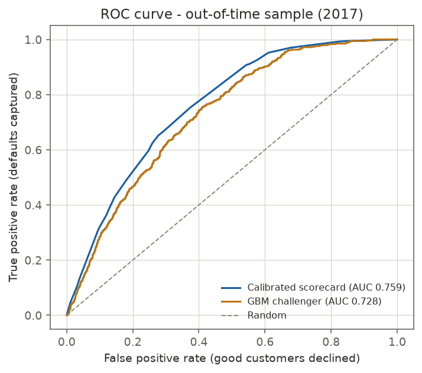

*AUC 0.759 out of time, with the challenger's curve for comparison.*

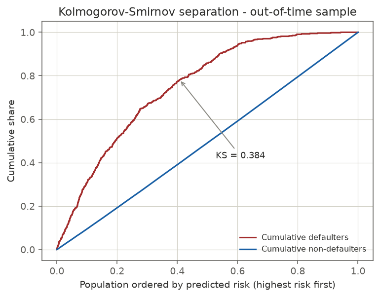

*KS separation: 38.4% of the good/bad cumulative distributions' maximum gap.*

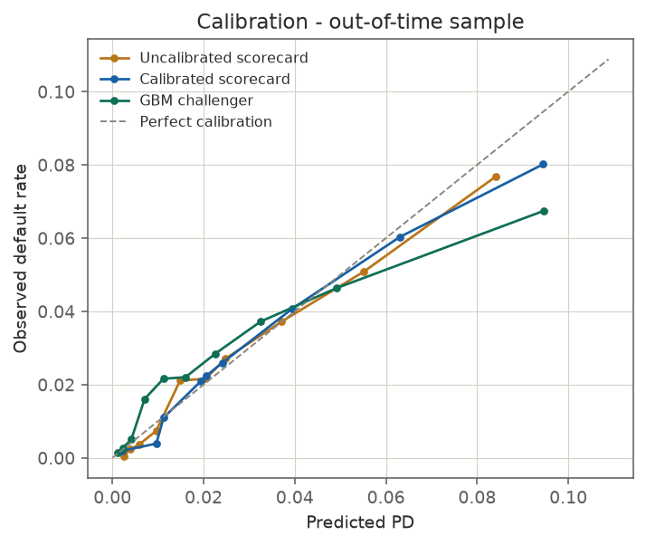

*Isotonic recalibration fitted on 2016 and frozen before being applied to 2017.*

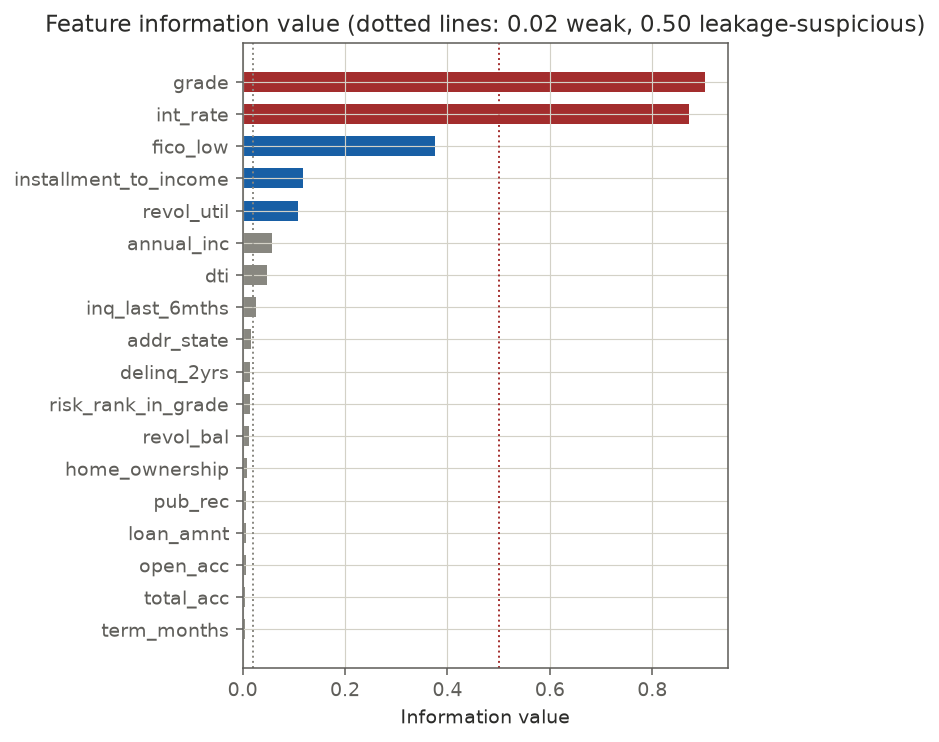

*IV per feature. Dotted lines mark the weak threshold (0.02) and the leakage review ceiling (0.50).*

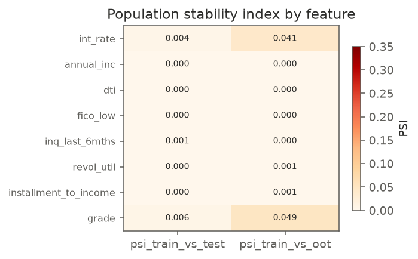

*Population stability by feature between the training window and later populations.*

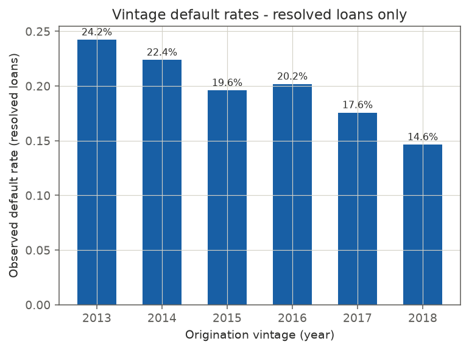

*Observed default rate by origination vintage, resolved loans only.*

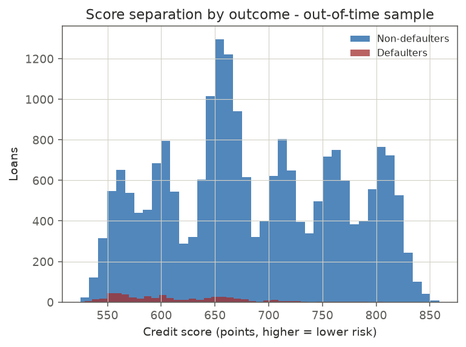

*Score separation between defaulters and non-defaulters out of time.*

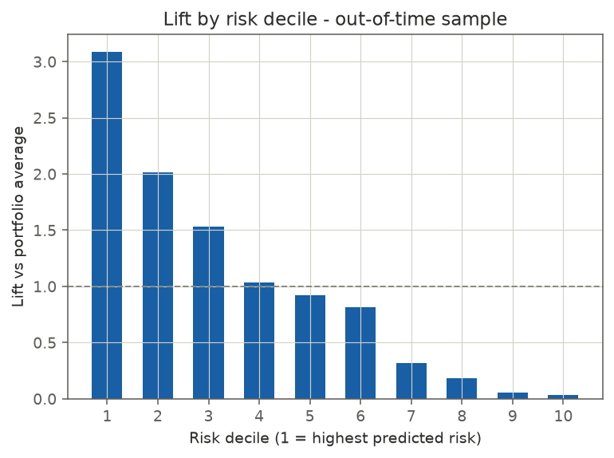

*Lift by risk decile.*

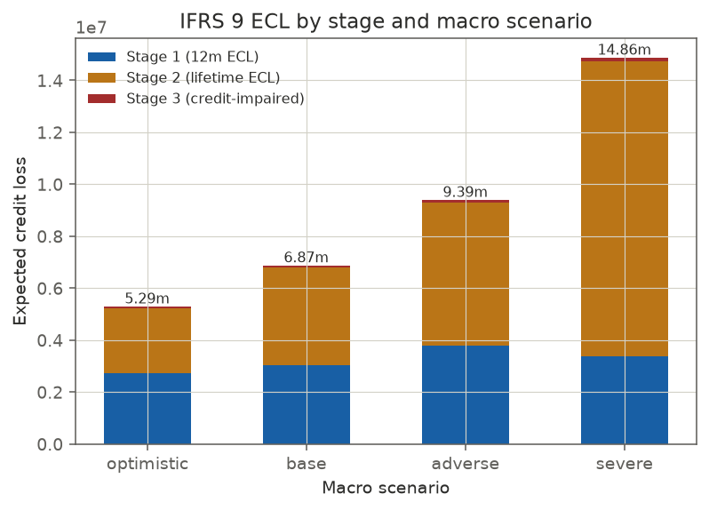

*IFRS 9 ECL decomposed by stage across the four macro scenarios.*

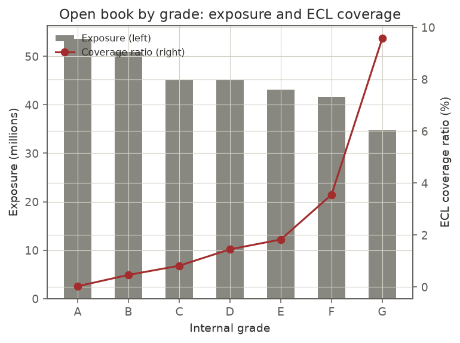

*Exposure and ECL coverage ratio by internal grade.*

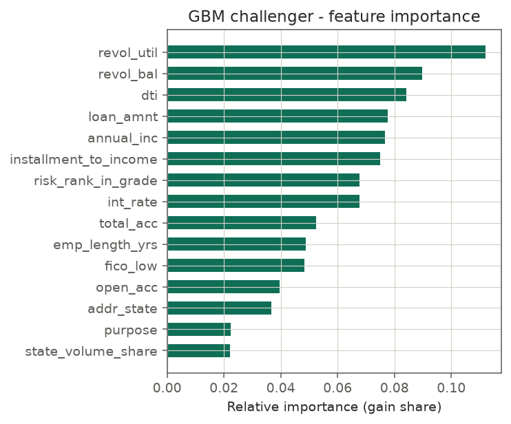

*GBM challenger feature importance, for contrast with the scorecard's points.*

## 4. Data sources and how to obtain them

| Source                                                      | Use                                                                   | Access                                                                                                        |
| ----------------------------------------------------------- | --------------------------------------------------------------------- | ------------------------------------------------------------------------------------------------------------- |
| **Synthetic book** (default)                                | Reproducible pipeline validation with a known data-generating process | Generated in-process, seeded, no download                                                                     |
| **LendingClub loan-level extract** 2007–2018Q4, ~2.9m loans | Real market data                                                      | Kaggle: `wordsforthewise/lending-club`. Rename to `loan.csv`, place in `data/raw/`, then `make pipeline-real` |
| **Macro series** (unemployment, HPI, GDP)                   | Scenario calibration                                                  | Bundled illustrative series for the synthetic mode; replace with FRED / ECB / CSO series in production        |

No data is committed to the repository. `data/raw/` holds only a `.gitkeep`.

## 5. Methodology

### 5.1 SQL warehouse (all transformations version-controlled)

```
sql/01_staging.sql        typed, de-duplicated staging layer (ROW_NUMBER de-duplication)
sql/02_data_quality.sql   missingness, ranges, duplicates, label distribution by vintage
sql/03_features.sql       analytic-SQL feature engineering
sql/04_feature_mart.sql   frozen modelling mart, split definition, open book, LGD benchmark
```

Four of the model inputs are built in SQL rather than pandas, because on a real book the loan table  
is too large to pull into memory and the aggregation belongs where the data lives:

- `borrower_prior_loans` — `ROW_NUMBER() OVER (PARTITION BY member_id ORDER BY issue_date)`
- `state_volume_share` — `COUNT(*) OVER (PARTITION BY addr_state)`
- `risk_rank_in_grade` — `PERCENT_RANK() OVER (PARTITION BY grade ORDER BY int_rate)`
- `installment_to_income` — derived in the mart

```sql
-- risk rank within grade: a loan priced at the top of its grade is riskier than
-- one priced at the bottom, and the raw grade alone cannot see that
grade_rank AS (
    SELECT
        loan_id,
        PERCENT_RANK() OVER (PARTITION BY grade ORDER BY int_rate) AS risk_rank_in_grade
    FROM base
)
```

### 5.2 Target definition — the decision that keeps the whole project coherent

The PD model is fitted on **default within 12 months of origination** (`default_flag_12m`), not on  
the lifetime "did this loan ever charge off" outcome.

This matters more than it looks. A lifetime label fed into an ECL engine that then treats it as a  
one-year probability and compounds it over the remaining term does not merely shift the answer — it  
inflates the provision by a large multiple. Defining the target over a fixed 12-month window puts  
PD, the term structure and the ECL horizon on the same clock. Lifetime rates are still computed and  
reported, but they are used for vintage analysis and for the workout models, where the full-life  
outcome is the correct quantity.

### 5.3 Leakage guard

`config.LEAKAGE_COLUMNS` lists everything only observable after origination — repayment totals,  
recoveries, outstanding balance, days past due, the outcome itself. A test asserts that the feature  
set and the leakage set are disjoint:

```python
def test_encoder_never_uses_a_leakage_column():
    assert set(cfg.LEAKAGE_COLUMNS) & set(cfg.MODEL_FEATURES) == set()
```

### 5.4 Weight-of-evidence binning and information value

1. Equal-frequency initial bins, missing values held as their own bin.
2. Adjacent bins merged until WOE is monotonic in either direction, always merging the adjacent pair  
   whose WOE values are closest — the pair that costs the least discriminatory information.
3. Thin bins folded into their neighbour before merging.
4. IV computed per feature; a **lower** bound screens weak features out.

A high IV is treated as a **review trigger, not a deletion rule**. `grade` (IV 0.90) and `int_rate`  
(IV 0.87) are the two strongest inputs in the book and both are legitimate origination-time  
information — the lender's own risk assessment and the price it charged. Deleting them on an  
automatic leakage heuristic would remove the two best features in the model. The pipeline flags them,  
the report records the review outcome, and the reviewer decides.

### 5.5 PD: interpretable scorecard plus a boosted challenger

The scorecard is a WOE-transformed logistic regression scaled to points:

```
score = offset - factor * logit(p)        factor = PDO / ln 2,  offset = base_score - factor * ln(base_odds)
```

with `base_score = 600` at 20:1 odds and 50 points to double the odds. The full points sheet is  
exported to `outputs/tables/scorecard_points.csv`, so any application can be scored by hand.

The LightGBM challenger is fitted on raw features with a **frozen** category-to-code mapping. That  
detail is load-bearing: re-deriving codes from the scoring frame lets a category that is present in  
training and absent at scoring time shift every subsequent code, and the model degrades silently  
without raising an error.

### 5.6 Calibration

Isotonic recalibration is fitted on the test window and then frozen before being applied out of  
time. Fitting the calibrator on the same data used to evaluate it would report a calibration quality  
the model does not have.

### 5.7 LGD model — and the rule that lets it be discarded

LGD is modelled as `1 - recoveries / exposure at default` on resolved training defaults, regressed on  
origination characteristics (loan size, rate, term, FICO, DTI, income, grade, purpose, state) plus a  
loan-to-income ratio. **Time-to-default is deliberately excluded**: it is known for a workout that  
already happened and unavailable for a performing loan, so including it would produce an excellent  
in-sample fit and an unusable model.


The model is benchmarked against a grade-average lookup table:

| Basis | MAE (out-of-time) | R² | Mean LGD |
|---|---:|---:|---:|
| Modeled LGD | **0.0239** | **0.824** | 0.8905 |
| Grade-average lookup | 0.0408 | 0.473 | 0.8938 |

A **41.4% MAE improvement** earns the model its place, so it is selected for the base provision. The
selection is automatic and reported — if the model had failed this test the pipeline would have used
the lookup table and said so.

### 5.8 EAD model

For amortising term loans there is no undrawn commitment, so EAD is a *timing* problem: how much
principal will still be outstanding when the borrower defaults. The model therefore combines

1. a per-grade discrete default-timing distribution (hazard profile) estimated on training defaults
   with Laplace smoothing, and
2. the contractual amortisation schedule,

into an expected exposure per loan. Out of time, the predicted mean exposure ratio is 0.587 against
an observed 0.528. Per-loan MAE (0.2245) is *expected* to be large: the model predicts the
conditional mean, so its error is bounded below by the variance of realised default timing. It
should be judged on the mean and by grade, not per loan, and the report says so.

### 5.9 IFRS 9 staging and expected credit loss

| Stage | Trigger | Horizon | Loans (base) |
|---|---|---:|---:|
| 1 | Performing | 12 months | 19,716 |
| 2 | SICR: 12-month PD ≥ 6%, **or** 30+ days past due | Lifetime (remaining term) | 2,848 |
| 3 | Credit-impaired: 90+ days past due | Lifetime | 159 |

Both SICR triggers are required. The quantitative trigger alone would let a low modelled PD override
a delinquent loan; the 30+ days past due backstop cannot be switched off by a model.

The calculation walks the amortisation schedule month by month:

```
ECL = LGD * SUM over t [ marginal_PD(t) * EAD(t) * discount_factor(t) ]
```

Discounting is applied at the contractual rate (floored at 5%) because a shortfall expected in month
48 is not worth the same as one expected in month 3. Marginal, not conditional, PDs are used — a
conditional hazard multiplied by exposure double counts survival.

**Scenarios** (unemployment delta in percentage points, PD multiplier = exp(0.15 × ΔU)):

| Scenario | ΔU (pp) | Weight | ECL | Coverage ratio |
|---|---:|---:|---:|---:|
| Optimistic | −1.5 | 10% | 5,286,154 | 1.68% |
| Base | 0.0 | 50% | 6,869,152 | 2.18% |
| Adverse | +2.0 | 28% | 9,386,419 | 2.98% |
| Severe | +4.5 | 12% | 14,864,710 | 4.73% |
| **Probability-weighted** | | | **8,375,154** | **2.66%** |

An upside scenario is not decoration. A portfolio provisioned only against deterioration
systematically overstates its allowance, and IFRS 9 asks for a range of outcomes.

### 5.10 Sensitivity: how much of the provision is a policy choice?

The SICR threshold is a policy parameter, so its effect is disclosed rather than buried:

| SICR PD threshold | Stage 2 share | Total ECL | vs base |
|---:|---:|---:|---:|
| 3.0% | 27.1% | 7,836,557 | +14.1% |
| 4.5% | 14.2% | 7,012,341 | +2.1% |
| **6.0% (selected)** | **12.5%** | **6,869,152** | **0.0%** |
| 8.0% | 5.1% | 6,025,115 | −12.3% |
| 12.0% | 1.8% | 5,459,576 | −20.5% |

Moving a single threshold moves the provision by more than a third across the tested range. That is
the honest answer to "how reliable is this number", and it is the first question a reviewer asks.

### 5.11 Decision cut-off

Costs are expressed in the same unit — one default costs 1.0, one declined good applicant costs 0.05
in foregone margin. Sweeping the PD cut-off on the out-of-time sample minimises expected cost at a
**PD cut-off of 0.06**, an approval rate of **87.3%** and expected cost of **473 units**.

## 6. Key findings

1. **A calibrated, explainable scorecard is competitive here.** AUC 0.759 vs 0.728 for LightGBM. The
   internal grade carries most of the signal, and a monotonic binned linear model extracts it.
2. **Calibration was the binding constraint, not discrimination.** On synthetic data the ranking was
   good but the predicted PD levels needed isotonic correction before they could be used in a
   provision.
3. **Only one of four SQL-engineered features survived IV screening** (`installment_to_income`
   retained; `borrower_prior_loans`, `state_volume_share`, `risk_rank_in_grade` screened out as
   unpredictive). Feature engineering that does not survive screening is still worth building — the
   negative result is information.
4. **LGD modelling was worth it; EAD modelling is mostly about timing.** The LGD model cut MAE by
   41% against a grade lookup. The EAD model's value is the exposure profile it produces, not a
   better point forecast, because the contractual schedule already fixes most of the answer.
5. **The provision is materially sensitive to a policy threshold.** ±20% across the tested SICR
   range, which is why the sensitivity table ships with the model.

## 7. Limitations and what I would do next

* **The book is synthetic by default.** The generative process is documented and seeded; the
  structure of the pipeline is the deliverable, not the numbers.
* **No time-varying covariates.** Borrower characteristics are observed only at origination, so SICR
  cannot be driven by a genuine PD migration since origination — it is driven by the delinquency
  backstop and by the absolute PD level. A production model would score each account monthly on
  updated bureau data.
* **The macro overlay is a documented elasticity, not a fitted satellite model.** `exp(0.15 × ΔU)`
  is illustrative; a real bank regresses observed default rates on macro factors over a long
  history. Six annual observations would not support that regression, and pretending otherwise would
  be worse than stating the assumption.
* **LGD is a single-workout model** without a cure/re-default process, and EAD does not model
  prepayment, which would reduce exposure and therefore reduce ECL.
* **Next steps:** monthly behavioural scoring with bureau data; a satellite macro model; a
  prepayment model to sit alongside EAD; challenger monitoring with automatic PSI-triggered
  redevelopment; and backtesting of the staging migration matrix against realised stage transitions.

## 8. How to run

```bash
make setup        # install dependencies
make pipeline     # run everything on the synthetic book (~1 minute)
make test         # 60 tests
```

Or directly:

```bash
python scripts/run_pipeline.py                    # synthetic book, 120k loans
python scripts/run_pipeline.py --data-mode real   # LendingClub extract in data/raw/loan.csv
python scripts/run_pipeline.py --loans 250000     # larger synthetic book
```

Every artefact is regenerated from scratch: `outputs/figures/` (11 PNGs),
`outputs/tables/` (30 CSVs), `outputs/metrics.json` and `outputs/RESULTS.md`.

## 9. Project structure

```
.
├── sql/                           # transformations, executed in filename order
│   ├── 01_staging.sql
│   ├── 02_data_quality.sql
│   ├── 03_features.sql
│   └── 04_feature_mart.sql
├── src/creditrisk/
│   ├── config.py                  # paths, splits, business assumptions, scenarios
│   ├── data.py                    # synthetic generator + LendingClub ingestion
│   ├── warehouse.py               # SQLite build and query layer
│   ├── features.py                # WOE binning, IV, monotonic merging
│   ├── finmath.py                 # annuity, amortisation, hazard curves, discounting
│   ├── scorecard.py               # logistic scorecard + points scaling
│   ├── gbm.py                     # LightGBM challenger with frozen encoding
│   ├── calibration.py             # isotonic and Platt scaling
│   ├── metrics.py                 # AUC/Gini/KS, PSI, calibration, lift, expected cost
│   ├── lgd.py                     # LGD model + benchmark comparison
│   ├── ead.py                     # default timing model + exposure profile
│   ├── ecl.py                     # three-stage ECL engine, scenarios, SICR sensitivity
│   ├── plots.py                   # every figure in this README
│   └── report.py                  # orchestration and report generation
├── scripts/run_pipeline.py         # CLI entry point
├── tests/                          # 60 tests
├── MODEL_DOCUMENTATION.md          # model validation report
└── outputs/                        # generated figures, tables, metrics, RESULTS.md
```

**Tech stack:** Python 3.11+, pandas, NumPy, scikit-learn, LightGBM, matplotlib, SQLite (analytic
SQL with window functions), pytest, GitHub Actions.

## 10. Author and licence

Built by Wenqi Shi — MSc Finance with Data Analytics.

MIT licence, see `LICENSE`. The pipeline, the tests and the documentation are the work; the
underlying data belongs to its publishers.
